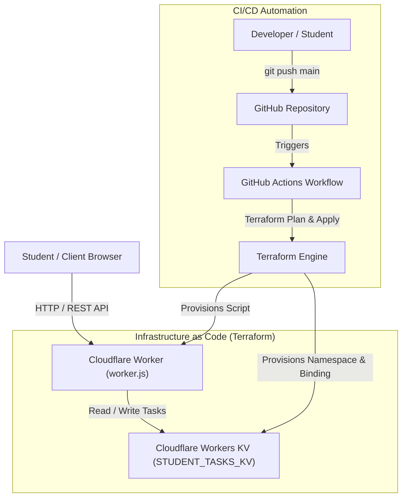

# Automated Deployment of a Serverless Student Task Management Application Using Terraform

A Cloud Computing classroom assignment demonstrating **Infrastructure as Code (IaC)**, **Serverless Cloud Architecture**, and **Automated CI/CD Pipelines**.

---

## 📌 Project Overview

This project implements and automates the end-to-end deployment of a **Serverless Student Task Management Application** using:
- **Terraform** for declarative cloud infrastructure provisioning.
- **Cloudflare Workers** for serverless REST API execution.
- **Cloudflare Workers KV** for persistent, low-latency key-value task storage.
- **HTML5, CSS3, and JavaScript** for a client-side management dashboard.
- **Git & GitHub** for version control.
- **GitHub Actions** for automated CI/CD linting, planning, and deployment.

---

## 🏗️ System Architecture



---

## 📁 Project Directory Structure

```text
student-task-manager-iac/
├── .github/
│   └── workflows/
│       └── deploy.yml              # GitHub Actions CI/CD pipeline
├── application/
│   ├── index.html                  # Responsive Student Task Manager UI
│   ├── style.css                   # Modern CSS styling and badges
│   ├── script.js                   # Frontend controller & API client
│   └── worker.js                   # Cloudflare Worker REST API implementation
├── screenshots/
│   └── .gitkeep                    # Verification screenshots placeholder
├── terraform/
│   ├── main.tf                     # Core Cloudflare Worker & KV resource definitions
│   ├── outputs.tf                  # Exported outputs (KV ID, Worker name)
│   ├── providers.tf                # Cloudflare Terraform provider configuration
│   ├── variables.tf                # Input variable declarations
│   └── terraform.tfvars.example    # Template for local environment variables
├── .gitignore                      # Git ignore rules for state, secrets, and caches
└── README.md                       # Classroom documentation & setup guide
```

---

## 🧰 Technology Stack

| Component | Technology | Description |
| :--- | :--- | :--- |
| **IaC Tool** | HashiCorp Terraform (>= 1.5.0) | Automates cloud resource provisioning and lifecycle management |
| **Compute / API** | Cloudflare Workers | V8-based serverless edge compute handling CRUD REST requests |
| **Database** | Cloudflare Workers KV | Distributed, high-availability key-value store |
| **Frontend** | HTML5, CSS3, Vanilla JavaScript | Responsive academic task tracker with metrics and filtering |
| **CI/CD** | GitHub Actions | Automated lint, validate, plan, and apply pipeline |
| **Version Control** | Git & GitHub | Source tracking and team collaboration |

---

## 📋 Environment Prerequisites

Before deploying the project, ensure the following tools are installed on your workstation:

1. **Git** (Version >= 2.x)
   - Verify: `git --version`
2. **Terraform CLI** (Version >= 1.5.0)
   - Verify: `terraform -v`
   - Download: [developer.hashicorp.com/terraform/install](https://developer.hashicorp.com/terraform/install)
3. **Node.js** (Version >= 18.x) & npm
   - Verify: `node -v`
4. **Cloudflare Account & API Token**
   - Free tier Cloudflare account.
   - API Token created with:
     - `Account > Workers KV Storage > Edit`
     - `Account > Workers Scripts > Edit`

---

## 🚀 Step-by-Step Setup & Terraform Deployment

### 1. Clone the Repository
```bash
git clone https://github.com/<your-username>/student-task-manager-iac.git
cd student-task-manager-iac
```

### 2. Configure Local Terraform Variables
Navigate into the `terraform/` directory and create `terraform.tfvars`:
```bash
cd terraform
cp terraform.tfvars.example terraform.tfvars
```

Edit `terraform.tfvars` with your credentials:
```hcl
cloudflare_api_token  = "your_cloudflare_api_token_here"
cloudflare_account_id = "your_cloudflare_account_id_here"
project_name          = "student-task-manager"
environment           = "dev"
```
> [!WARNING]
> Never commit `terraform.tfvars` or any file containing API tokens to version control. The `.gitignore` is preconfigured to prevent secret leaks.

### 3. Initialize Terraform
```bash
terraform init
```

### 4. Validate Configuration
```bash
terraform fmt -check
terraform validate
```

### 5. Review Execution Plan
```bash
terraform plan
```

### 6. Apply and Provision Infrastructure
```bash
terraform apply
```
When prompted, type `yes` to confirm. Terraform will provision:
- A new Cloudflare Workers KV Namespace (`student-task-manager-dev-kv`).
- The Cloudflare Worker script (`student-task-manager-dev-worker`) bound to `STUDENT_TASKS_KV`.

---

## 🔄 GitHub Actions CI/CD Setup

To automate deployments via GitHub Actions:

1. Navigate to your repository on GitHub.
2. Go to **Settings > Secrets and variables > Actions**.
3. Add the following **Repository Secrets**:
   - `CLOUDFLARE_API_TOKEN`: Your Cloudflare API Token.
   - `CLOUDFLARE_ACCOUNT_ID`: Your Cloudflare Account ID.
4. When you open a Pull Request against `main`, the workflow executes `terraform fmt`, `terraform init`, `terraform validate`, and `terraform plan`.
5. When changes are pushed/merged into `main`, the workflow executes `terraform apply -auto-approve`.

---

## 📡 REST API Reference

The deployed Cloudflare Worker exposes the following endpoints:

| Method | Endpoint | Description | Sample Payload |
| :--- | :--- | :--- | :--- |
| `GET` | `/api/health` | Service health status check | — |
| `GET` | `/api/tasks` | Retrieve all student tasks from KV | — |
| `POST` | `/api/tasks` | Create a new task | `{"title":"Lab 1","course":"CS-450","priority":"High","status":"Pending"}` |
| `PUT` | `/api/tasks/:id`| Update an existing task | `{"status":"Completed"}` |
| `DELETE`| `/api/tasks/:id`| Remove task by unique key | — |

---

## 🛡️ Security & Best Practices

- **Zero Hardcoded Secrets**: All tokens and account identifiers are parameterized via Terraform variables and GitHub Secrets.
- **Stateless Edge Execution**: The application uses serverless Workers with sub-millisecond cold starts.
- **Consistent IaC State**: Infrastructure lifecycle is completely repeatable and auditable via Terraform.
